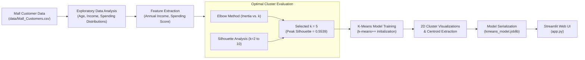

# 🛍️ Customer Segmentation & Persona Discovery: Unsupervised Machine Learning

[](https://www.python.org/)
[](https://scikit-learn.org/)
[](https://streamlit.io/)
[](LICENSE)

An end-to-end unsupervised machine learning project that segments retail customers into 5 distinct behavioral personas using **K-Means Clustering**. Built on the benchmark [Kaggle Mall Customer Segmentation Dataset](https://www.kaggle.com/datasets/vjchoudhary7/customer-segmentation-tutorial-in-python).

---

## 📌 Project Overview

Treating all customers with the same marketing strategy leads to low conversion and high acquisition costs. This project builds a customer segmentation engine that automatically categorizes shoppers based on **Annual Income** and **Spending Habits**, delivering targeted, actionable retail marketing strategies for each segment.

### Key Highlights
* **Single Master Notebook** ([`customer_segmentation.ipynb`](customer_segmentation.ipynb)): Complete exploratory data analysis, cluster evaluation, 2D scatter visualizations, and model export.
* **Mathematical Justification for $k$**: Rigorous validation combining the **Elbow Method (WCSS)** and **Silhouette Coefficient Analysis** to select the optimal $k=5$.
* **Actionable Behavioral Personas**: Clear business profiling of every segment (e.g., VIP High-Rollers, Impulsive Trendsetters, Frugal Affluents, and Budget Savers).
* **Interactive Streamlit Web Dashboard** ([`app.py`](app.py)): Live persona assignment with 1-click customer presets and real-time placement on the customer segmentation map.

---

## 🏗️ Architecture & Clustering Workflow



---

## 📊 Dataset Overview

| Feature | Type | Range | Description |
|:---|:---|:---:|:---|
| `CustomerID` | Identifier | 1 - 200 | Unique ID (dropped during modeling) |
| `Gender` | Categorical | Male / Female | Customer gender |
| `Age` | Numeric | 18 - 70 | Customer age (Mean: ~38.8 years) |
| `Annual Income (k$)` | Numeric | $15k - $137k | Annual income in thousands of USD |
| `Spending Score (1-100)`| Numeric | 1 - 99 | Score assigned based on purchase history and basket size |

---

## 📐 Determining the Optimal Number of Clusters ($k$)

We evaluate $k \in [2, 10]$ using both **Inertia (Within-Cluster Sum of Squares)** and the **Silhouette Coefficient**:

| Number of Clusters ($k$) | Inertia (WCSS) | Silhouette Score | Trend Interpretation |
|:---:|:---:|:---:|:---|
| $k = 2$ | 181,363.6 | 0.2969 | Poor separation |
| $k = 3$ | 106,348.4 | 0.4676 | Moderate separation |
| $k = 4$ | 73,679.8 | 0.4932 | Improving separation |
| **$k = 5$ (Selected)** | **44,448.5** | **0.5539** | **Sharp Elbow Point & Global Maximum Silhouette Score** |
| $k = 6$ | 37,233.8 | 0.5398 | Decreasing silhouette score |
| $k = 7$ | 30,241.3 | 0.5288 | Over-segmentation |
| $k = 8$ | 25,036.4 | 0.4548 | Diminishing cluster separation |

> **Conclusion**: $k = 5$ represents the clear elbow inflection point where reduction in inertia slows down, while simultaneously achieving the highest silhouette score ($0.5539$).

---

## 🏷️ The 5 Customer Personas & Marketing Strategies

| Cluster ID | Persona Name | Mean Income | Mean Spending | Customer Share | Strategic Marketing Action Plan |
|:---:|:---|:---:|:---:|:---:|:---|
| **1** | **VIP / High Spenders** | **$86.5k** | **82.1** | **19.5%** | **Prime Growth Driver**: Target with luxury product launches, VIP loyalty programs, and personalized concierge offers. |
| **2** | **Impulsive / Trendsetters** | **$25.7k** | **79.4** | **11.0%** | **High Engagement**: Younger demographic (~25 yrs). Target with flash sales, social media trends, and Buy-Now-Pay-Later payment plans. |
| **0** | **Standard / Mainstream** | **$55.3k** | **49.5** | **40.5%** | **Volume Backbone**: Largest customer group (~40%). Maintain engagement with seasonal discounts and membership rewards. |
| **3** | **Careful / Savers** | **$88.2k** | **17.1** | **17.5%** | **Untapped Wealth**: High income but conservative spenders. Focus on product durability, warranties, and premium value-add propositions. |
| **4** | **Budget / Sensible** | **$26.3k** | **20.9** | **11.5%** | **Price-Conscious**: Older demographic (~45 yrs) with limited budget. Attract with coupons, clearance items, and essential bundles. |

---

## 🌐 Streamlit Web Application (`app.py`)

The application allows marketing teams to interactively segment any customer profile:
* **Interactive Profile Controls**: Sliders for Annual Income, Spending Score, Age, and Gender.
* **1-Click Customer Presets**:
  * 🎯 *VIP / High Spender* ($88k, Score 82)
  * ⚡ *Impulsive Trendsetter* ($25k, Score 80)
  * 💼 *High-Wealth Saver* ($85k, Score 15)
  * 🏷️ *Budget Shopper* ($22k, Score 20)
  * 🛒 *Mainstream Shopper* ($55k, Score 50)
* **Real-Time Persona Insights**: Instant display of the assigned persona badge, core characteristics, and recommended retail marketing campaign.
* **Live 2D Customer Map**: Color-coded scatter plot visualizing the entire 200-shopper customer space, cluster centroids, and the **new shopper's location plotted as a prominent marker**.

---

## 🚀 Quickstart & Reproduction

### 1. Clone & Install Dependencies
```bash
git clone https://github.com/your-username/customer-segmentation.git
cd customer-segmentation

# Optional: Create virtual environment
python -m venv venv
# On Windows: venv\Scripts\activate
# On Linux/macOS: source venv/bin/activate

pip install -r requirements.txt
```

### 2. Run the Master Jupyter Notebook
```bash
jupyter notebook customer_segmentation.ipynb
```
Executes the full EDA, generates the Elbow and Silhouette plots, fits K-Means, and saves `kmeans_model.joblib`.

### 3. Launch the Streamlit App
```bash
streamlit run app.py
```
Open `http://localhost:8501` in your browser.

---

## 📂 Project Structure

```text
customer-segmentation/
├── data/
│   └── Mall_Customers.csv          # Official Kaggle Mall Customer dataset (200 records)
├── customer_segmentation.ipynb     # Master notebook: EDA, Elbow method, clustering & export
├── app.py                          # Interactive Streamlit customer segmentation dashboard
├── kmeans_model.joblib             # Serialized K-Means model payload & cluster metadata
├── requirements.txt                # Python dependencies
├── README.md                       # Comprehensive project documentation
├── .gitignore                      # Clean Git repository ignore rules
└── LICENSE                         # MIT License
```

---

## 📄 License
This project is open-source and available under the [MIT License](LICENSE).
